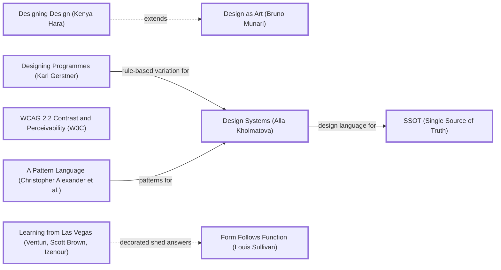

# DESIGN-LOG: site-repo (DADA run, 2026-11-11)

## Traversal Plan

**Brief, restated:** Turn five loose Tailwind snippets into a library of website parts that humans and agents can both use. The parts are copy-paste HTML templates, with a sandbox for seeing changes live, and the result should be designed well.

The owner's words: "Should eb a place for humans and agents to get template shit for building websites with a little sandbox or something to see chnages idk design good dada project".

**Mode: Adaptive.** The site serves a public of site builders and AI agents, so MAYA governs:
- The advanced pole is a kit of parts with an X-ray view.
- The acceptable pole is copy-paste HTML that works anywhere.

**Run type: Full** (a redesign).

**Bound:** none stated.

### Tooling (Step 0)

| Job | Tool |
|---|---|
| Graph | Mermaid text in this log (no renderer available) |
| Frontier | Edges grepped by hand from `references/anchor-graph.md` |
| Workflow state | This log |
| Panel | Agent tool, one sub-agent per seat, at most 3 at a time, each filing to `panel/<round>/<seat>.md` |
| Collect | `scripts/collect_panel.py` |
| Seating | `scripts/pick_panel.py --mode adaptive --run-type full --project site-repo` |
| Briefs | `seats/<id>.md` |
| Measurement | Playwright (`build/check.mjs`) |
| Ledger | SolutionsAsService/dada-changes (the owner's account), a session branch plus a patch file, as the other runs are recorded |

### Panel (from pick_panel.py)

| Seat | Why |
|---|---|
| Critic: Provocateur (Debord) | required (Adaptive) |
| Critic: Provocateur (Shklovsky) | required (Adaptive) |
| Critic: Inclusion (Holmes) | required (Adaptive) |
| Critic: Inclusion (Mace) | required (Adaptive) |
| Critic: Evidence (Cairo) | required: the artifact can be inspected |
| Critic: Usability (Krug) | rated 0.844 |
| Critic: Craft (Bringhurst) | rated 0.739 |
| Critic: Erasure (Kelly Walters) | rotation, 0 rounds on record |

The dotted pairs are Debord with Krug and Shklovsky with Krug.

**Witness:** none. The artifact describes no system owned by another party. The OpenStreetMap embed URL format is public and is checked by Cairo.

### Seed (exact labels)

- **Stance:** Design as Art (Bruno Munari).
- **Rules:** Designing Programmes (Karl Gerstner); WCAG 2.2 Contrast and Perceivability (W3C).
- **Systems:** Design Systems (Alla Kholmatova); A Pattern Language (Christopher Alexander et al.).
- **Breaker:** Learning from Las Vegas (Venturi, Scott Brown, Izenour).
- **Counterpoints (dotted):**
  - `hara -.->|extends| munariDA` — Designing Design (Kenya Hara).
  - `venturi2 -.->|decorated shed answers| sullivan` — Form Follows Function (Louis Sullivan).

Chain:

> Designing Programmes (Karl Gerstner) -->|rule-based variation for| Design Systems (Alla Kholmatova) · A Pattern Language (Christopher Alexander et al.) -->|patterns for| Design Systems (Alla Kholmatova) -->|design language for| SSOT (Single Source of Truth) · Design as Art (Bruno Munari) -.extends.- Designing Design (Kenya Hara) · Learning from Las Vegas (Venturi, Scott Brown, Izenour) -.->|decorated shed answers| Form Follows Function (Louis Sullivan).

### Initial Frontier

| Candidate | Reached via | From | Status |
|---|---|---|---|
| R0 objections | premortem | — | TAKEN (M1–M9) |
| Tokens as the programme's parameters | gerstner -->\|rule-based variation for\| kholmatova | Designing Programmes | TAKEN (M1) |
| Numbered patterns | alexPattern -->\|patterns for\| kholmatova | A Pattern Language | TAKEN (M2) |
| One source builds the gallery, the registry and the sandbox | kholmatova -->\|design language for\| c_ssot | Design Systems | TAKEN (M3) |
| The library dressed as a model kit (the sprue) | venturi2 (Breaker) | Learning from Las Vegas | TAKEN (M5) |
| Function shown bare, with no decoration (X-ray) | venturi2 -.-> sullivan | Form Follows Function | TAKEN (M6) |
| Emptiness as invitation: the sandbox starts blank-ish | hara -.-> munariDA | Designing Design | TAKEN (M4) |
| Accessibility as the taught default | wcag | WCAG 2.2 | TAKEN (M2, M7) |

---

## Panel, WHOLE, round R0 (premortem on commit 60a28d6; panel/R0/*.png; evidence panel/R0/evidence.md)

All 8 seats filed (`collect_panel.py`: 8 of 8).

| Critic | Anchor used | Observed in the work | Verdict | Requested change |
|---|---|---|---|---|
| Critic: Evidence (Cairo) | How Charts Lie | The evidence is accurate but incomplete: 2 of 3 icons were huge, not 3; there is no `</form>`; the map URL is malformed; the placeholder hrefs have spaces; CONTRIBUTING claims tests and a README that do not exist | OBJECT | Each part states its dependencies in the file; CONTRIBUTING made true |
| Critic: Usability (Krug) | Don't Make Me Think | No index: the first screen is a file list; a pasted part fails silently; dead nav links; the placeholders cannot be read by a machine | OBJECT | One sentence plus a preview of every part; a copy button and requirements; a gallery for humans and a manifest for agents from one source |
| Critic: Provocateur (Debord) | Society of the Spectacle | An image of navigation (4 dead pages), an image of contact (no backend), "X" on the bird | OBJECT | Declare requirements; the sandbox renders the exact copied source and shows what breaks |
| Critic: Inclusion (Holmes) | Mismatch | 0 of 4 labels; emoji names; untitled iframe; the parts work only for insiders | OBJECT | Labels; text names; titled map with a fallback; self-contained parts with a plain-language card |
| Critic: Inclusion (Mace) | Principles of Universal Design | Ring via box-shadow (lost in forced colours); inputs 21 px; nav links 4 px apart; active state by colour | OBJECT | `:focus-visible` outline; 44 px targets; aria-current; an access note per part; a forced-colours toggle |
| Critic: Craft (Bringhurst) | Elements of Typographic Style | No type system; stray "// Home Emoji"; emoji wordmark; capitals not letterspaced | OBJECT | Type tokens (base, leading, measure); show parts beside running text |
| Critic: Provocateur (Shklovsky) | Art as Technique | Every fragment is habitual; the only estrangement is the accidental 1000 px bird | OBJECT | A deliberate "bare / built" view in the sandbox |
| Critic: Erasure (Kelly Walters) | Black, Brown + Latinx Design Educators | Hidden prerequisites; docs that contradict the code; one locale | OBJECT | A "Needs:" line per part; vary the example people and places; add `lang` |

**Statements of meaning:** a library that promises parts and delivers fragments that depend on something unnamed.

**Andon:** none. Every objection becomes a Frontier item.

### Resolutions R0

| Finding | Resolution |
|---|---|
| Cairo + Debord + Walters + Holmes: hidden dependencies (Tailwind, undefined classes, API key, backend) | ADAPT (M1, M2): parts are plain HTML plus a scoped `<style>`; every token has a fallback value; each part's JSON header lists `needs` (empty for most) |
| Krug + Debord + Mace + Holmes + Walters: no labels, missing `</form>`, emoji names, untitled iframe, dead links | ADAPT (M2): rewritten parts with labels, text names, a titled OpenStreetMap embed (no key) with a text address, and slots instead of dead pages |
| Krug + Holmes: placeholders unreadable by machines; two front doors | ADAPT (M3): `data-slot` attributes plus a slot table in the JSON header; one source builds the gallery, the registry.json and llms.txt |
| Debord + Shklovsky: the sandbox must render the exact source and show what breaks | ADAPT (M4, M6): the preview is `srcdoc` = the copied string; the X-ray view strips the styles |
| Mace: focus by box-shadow; small targets; colour-only active state | ADAPT (M2, M7): `:focus-visible` outlines, 44 px targets, aria-current underline; probes in the check |
| Bringhurst: no type system; capitals not letterspaced | ADAPT (M1): tokens for body/display/mono faces, leading and measure; capitals letterspaced at 0.07–0.08em |
| Walters: one locale | ADAPT (M2, M8): varied people and places in the samples (Fremantle, Lagos, Mexico City), `lang` on every page |
| Cairo + Debord + Walters: CONTRIBUTING claims are false | ADAPT (M9): rewritten to match the build and check |
| Mace: a forced-colours / reduced-motion toggle in the sandbox | DEFERRED: the sandbox offers X-ray, widths and themes; forced colours are tested by the check. Logged on the Frontier |

---

## Decision Records

## Move M1: Tokens as the programme  (KEEP-THE-RULE)
Depends on: none
Anchors: Rule Designing Programmes (Karl Gerstner) | System Design Systems (Alla Kholmatova)
Intent: One `tokens.css` holds 15 variables for colour, radius, space, width, measure, leading and three faces. `themes.json` holds 4 presets (Paper, Night, Citrus, Slab). Every part reads only these tokens, each with a fallback, so a part works pasted alone and re-themes when the tokens change.
Formal argument: Gerstner's programme is a set of rules that generates many solutions. Kholmatova's design language makes those rules shared and named. Fallbacks make the programme degrade gracefully.
Alternatives rejected:
- (a) Keep Tailwind. Rejected: it was the hidden dependency.
- (b) One global stylesheet. Rejected: a part copied alone would lose its styles.
Consequence: Each part carries about 1–2 KB of scoped CSS. Some duplication is accepted for portability.
Fence: n/a.
Frontier effect: Theme switching in the sandbox and on the landing; contrast checks per theme.
Mode field: The advanced pole is that one edit re-themes every part. The acceptable pole is CSS variables anyone can read.

## Move M2: Eighteen numbered parts  (KEEP-THE-RULE)
Depends on: M1
Anchors: System A Pattern Language (Christopher Alexander et al.) | Rule WCAG 2.2 Contrast and Perceivability (W3C)
Intent: Rewrite the 5 fragments and add 13 more, for 18 parts in 7 groups. Each starts with a JSON header: id, title, category, summary, slots, needs and a11y notes. Each part is numbered by the build like Alexander's patterns (No. 01–18) and lettered by group (A–G).
Formal argument: Alexander's patterns are numbered, named and cross-referenced so non-experts can compose them. Accessibility is built in, so every copy teaches it.
Alternatives rejected:
- (a) A huge library of 100+ parts. Rejected: quality cannot be checked.
- (b) Keep the old 5 and patch them. Rejected: every one fails R0.
Consequence: The sample copy must be real-sounding and varied (Walters).
Fence: n/a.
Frontier effect: The check probes each part at 3 widths.
Mode field: The advanced pole is a numbered pattern language. The acceptable pole is copy-paste HTML.

## Move M3: One source builds three doors  (KEEP-THE-RULE)
Depends on: M1, M2
Anchors: Catalog SSOT (Single Source of Truth) | System Design Systems (Alla Kholmatova)
Intent: `build/build.mjs` reads `parts/` and `templates/` and writes:
- the human site (landing, part pages, templates, sandbox, agents page)
- the agent doors: `registry.json` (every part with its metadata, raw URL, sha256 and check results), `llms.txt`, and the raw files under `/raw/`
- the repo's `AGENTS.md`, which explains the format.
Formal argument: Two front doors (Krug) from one source cannot disagree.
Alternatives rejected:
- (a) A separate docs site. Rejected: it drifts.
- (b) A framework such as Astro. Rejected: it adds a dependency to a no-dependency library.
Consequence: A Node build step for the site only; the parts themselves need none.
Fence: n/a.
Frontier effect: Registry hashes must match the raw files (probe).
Mode field: The advanced pole is a machine registry. The acceptable pole is a gallery.

## Move M4: The sandbox  (KEEP-THE-RULE)
Depends on: M1, M3
Anchors: Stance Design as Art (Bruno Munari) | Counterpoint Designing Design (Kenya Hara) (dotted "extends")
Intent:
- Pick parts to stack into a page and edit the HTML in a code box.
- Change the tokens with controls (accent, ink, paper, radius, display face) or a theme preset.
- See the result in a frame at 375, 768 or 1280 width.
- Copy or download the exact document shown. The preview `srcdoc` is the same string that is copied.
- State is kept in the URL hash (part ids and tokens), so a link reproduces the page.
Formal argument: Munari wants design to be used, not admired. Hara's emptiness invites making. The sandbox opens with three parts, not a finished site.
Alternatives rejected:
- (a) An embedded CodePen or Monaco. Rejected: a network dependency.
- (b) A preview only, with no editing. Rejected: the brief says "see changes".
Consequence: A plain textarea editor, with no syntax colouring.
Fence: n/a.
Frontier effect: X-ray (M6); probe that the preview equals the copy.
Mode field: The advanced pole is a live, themeable assembly. The acceptable pole is a textarea and a frame.

## Move M5: The landing as a sprue  (BREAK)
Depends on: M2, M3
Anchors: Breaker Learning from Las Vegas (Venturi, Scott Brown, Izenour) | Stance Design as Art (Bruno Munari)
Intent: The first screen is a model-kit sprue: a frame with runners holding all 18 parts as live miniatures. Each part has its letter-number (A1, B2…) on a tab and links to its page. A theme switcher on the frame re-themes every miniature at once. An "assembly instructions" panel links to Sandbox, Templates and Agents.
Formal argument: Venturi's decorated shed lets the sign be the building. Here the library's sign is a kit, and the kit is the content: live parts, not screenshots. Shklovsky's estrangement: the web page seen as a moulded part, the habitual seen anew.
Alternatives rejected:
- (a) A grid of cards. Rejected: the habitual form.
- (b) One big demo page as the hero. Rejected: it does not summarize the 18 parts or the other doors.
Consequence: 18 iframes on the first screen. On a phone, show one part per group (7) and a "+11" tab, measured against the fold.
Fence: A card grid exists because it scans; the sprue keeps a grid (the runners) and changes only its dress.
Frontier effect: First-screen and legibility probes; theme switch probe.
Mode field: The advanced pole is a kit sprue of live parts. The acceptable pole is labelled tabs, a grid, and links.

## Move M6: X-ray  (BREAK; counterpoint applied)
Depends on: M4
Anchors: Counterpoint Form Follows Function (Louis Sullivan) (dotted from Learning from Las Vegas) | Breaker Learning from Las Vegas (Venturi, Scott Brown, Izenour)
Intent: A toggle on every part page and in the sandbox removes the part's styles and draws each element's tag and each `data-slot` name on it, showing the bare structure an agent fills.
Formal argument: Shklovsky asked for "bare / built". Sullivan's counterpoint to Venturi says the shed must also show its function, and X-ray is the function seen without its decoration.
Alternatives rejected:
- (a) A view-source panel only. Rejected: it shows code, not structure.
- (b) Browser devtools. Rejected: not for everyone.
Consequence: X-ray CSS injected only in previews, never in copied code.
Fence: n/a.
Frontier effect: Probe that X-ray changes the preview and leaves the copy unchanged.
Mode field: The advanced pole is that the structure is seen. The acceptable pole is a labelled toggle.

## Move M7: The check, published  (KEEP-THE-RULE)
Depends on: M2, M3
Anchors: Rule WCAG 2.2 Contrast and Perceivability (W3C)
Intent: `build/check.mjs` renders every part alone at 375, 768 and 1280 under each theme. It checks:
- overflow
- labels
- target size
- focus ring after a real Tab
- text contrast
- the presence of the JSON header and slots

Results are written into `registry.json` and shown on each part page. A failing fixture proves the probes work.
Formal argument: Debord: a library's claims must be earned. A published check turns a claim into evidence.
Alternatives rejected:
- (a) A badge with no data. Rejected: that is spectacle.
- (b) Manual review only. Rejected: it cannot be reproduced.
Consequence: Building takes about a minute longer.
Fence: n/a.
Frontier effect: Figures on the site come from the check.
Mode field: The advanced pole is per-part evidence. The acceptable pole is "passes at 375/768/1280".

## Move M8: Templates  (KEEP-THE-RULE)
Depends on: M2, M3
Anchors: System A Pattern Language (Christopher Alexander et al.)
Intent: Four full pages composed from parts with `<!--@part id-->` includes and overridden copy: a garden studio (Fremantle), an event (Lagos), a portfolio (Mexico City), and a product launch.
Formal argument: Alexander's patterns are proven only in a building. Templates show the parts composing.
Alternatives rejected:
- (a) No templates. Rejected: humans need a starting page.
- (b) A template per industry. Rejected: too many.
Consequence: Overrides are applied by string replacement in the build.
Fence: n/a.
Frontier effect: Templates are checked like parts.
Mode field: The advanced pole is composed from the pattern language. The acceptable pole is a page to start from.

## Move M9: Delete the old fragments; make the docs true  (KEEP-THE-RULE)
Depends on: M2
Anchors: Rule Designing Programmes (Karl Gerstner)
Intent: Delete navbar.html, forms.html, dividers.html, maps.html and social-media.html (each is replaced by a part). Rewrite CONTRIBUTING to describe the build, the check and the part format. Add a README and AGENTS.md.
Formal argument: Step 2f: each old file earns nothing its replacement does not hold.
Alternatives rejected:
- (a) Keep them in `legacy/`. Rejected: they would be copied.
- (b) Keep the docs as they are. Rejected: they are false.
Consequence: Old URLs disappear; there were no pages linking to them.
Fence: n/a.
Frontier effect: Residual diff.
Mode field: n/a.

---

## Panel, WHOLE, round R1 (commit a82970b; panel/R1/*.png; evidence panel/R1/evidence.md)

8 of 8 filed.

| Critic | Anchor used | Observed in the work | Verdict | Requested change |
|---|---|---|---|---|
| Critic: Evidence (Cairo) | How Charts Lie | Re-ran the check: 11/11 and 18/18, reproduced exactly. Bare paste passes; a stricter run passes; the hashes match parts/. But Playwright is not a declared dependency (hard-coded fallback path); the check line claims focus "in 4 themes" (it probes 1) and "24 px or more" (the probe allows spacing); a stale comment; slot exemptions undocumented; the registry hash check compares output with itself | OBJECT | Declare Playwright; make the published line say what the probe does; fix the comment; document the exemptions; hash against parts/ |
| Critic: Usability (Krug) | Don't Make Me Think | Five-second test passes for both users; C5 traced to its page; llms.txt and the registry usable. Phone doors are verbs without objects; phone tab titles truncated; "sprue" is jargon; Copy below the fold on part pages; tiny parts look empty | PASS | Objects under the verbs; two-line titles; plain words; Copy in the toolbar; crop the miniatures |
| Critic: Provocateur (Debord) | Society of the Spectacle | Core promises hold (bare render 18/18, Copy equals source 18/18, sandbox copy equals preview). But the nav-bar phone menu has no slots; slot exemptions contradict AGENTS.md; template links point to garden pages that do not exist; "24 px or more" overstates the probe; the preview adds a reset | OBJECT | Slot the menu links; document or drop the exemptions; real template anchors; quote the probe; label the reset |
| Critic: Inclusion (Holmes) | Mismatch | R0 F1–F7 resolved. Phone hides the lede; 18 live documents inside links (invalid HTML and noise for screen readers); truncated names; unglossed "sprue", "X-ray", "tokens" | OBJECT | Lede and door text on phone; previews inert/aria-hidden and outside the link; wrap names; inline glosses |
| Critic: Inclusion (Mace) | Principles of Universal Design | 37 landing stops, all with a 3 px ring; no trap in the sandbox; forced colours fixed. **hero-statement's focus ring is accent on the ink band: 1.00:1 in Slab, 1.78 Night, 2.68 Paper.** The probe ran focus in one theme only | OBJECT | A ring of 3:1 or better in every theme; probe focus contrast in all themes |
| Critic: Craft (Bringhurst) | Elements of Typographic Style | The R0 faults are gone (measure, leading, letterspaced caps, curly quotes, tabular figures). Truncated phone names; the .chk note is ~110 characters per line; the hero em breaks badly; ~12 sizes; two numbering systems | PASS | Wrap names; 65ch; `box-decoration-break: clone`; one scale; drop "No." |
| Critic: Provocateur (Shklovsky) | Art as Technique | The sprue is a real device; X-ray is the strongest and is buried (off, below the fold, smallest in the sandbox) | OBJECT | A bare/built switch on the sprue, on the first screen, X-raying all 18 at once |
| Critic: Erasure (Kelly Walters) | Black, Brown + Latinx Design Educators | R0 F1–F3 resolved, F4 partly. The agent is taught step by step but a human beginner is not; phone doors are bare verbs; part defaults are one business; no named learner | OBJECT | A "Paste your first part" page; full door labels; varied defaults; a named learner and a walkthrough |

**Andon:** none.

### Resolutions R1

| Finding | Resolution |
|---|---|
| Mace: hero-statement focus ring 1.00:1 in Slab | ADAPT (M13): ring in `--sr-paper` with 3 px offset (on the ink band), measured in all 4 themes |
| Mace + Cairo: focus probed in one theme only | ADAPT (M13): focus and focus-ring contrast (≥ 3:1 against the surface behind the element) probed in every theme |
| Cairo: Playwright undeclared; hard-coded path | ADAPT (M13): `playwright` in devDependencies, no machine path; README says so |
| Cairo + Debord: the published check line overstates the probes | ADAPT (M13): the line quotes the probes' own wording |
| Cairo: a stale focus-within comment | ADAPT (M13): comment corrected |
| Cairo + Debord: slot exemptions contradict AGENTS.md | ADAPT (M13): exemptions removed; the three attribute slots are marked on their elements (`data-slot` on the link with aria-current, the featured plan and the brand link) |
| Cairo: the registry hash check compares output with itself | ADAPT (M13): it hashes parts/ and compares with the registry |
| Debord: nav-bar phone menu not slotted | ADAPT (M13): menu links carry `data-slot="link"` |
| Debord: template links point to nonexistent pages | ADAPT (M13): template nav links point to sections that exist on that page (ids added by the template) |
| Debord: the preview adds a reset not in the copy | ADAPT (M13): the part page says "previewed with tokens.css and a 3-line reset (shown in the sandbox)" |
| Holmes: iframes inside links | ADAPT (M12): the preview iframes move outside the link, `aria-hidden` and `inert`; the link is the tab, stretched over the tile for the pointer |
| Holmes + Krug + Bringhurst + Walters: truncated names, bare phone verbs, hidden lede, jargon | ADAPT (M12): names wrap to two lines; the doors keep their objects at every width; a one-line lede on phone; "sprue" glossed in place |
| Krug: Copy below the fold | ADAPT (M12): "Copy code" in the part toolbar |
| Krug: empty-looking miniatures | ADAPT (M12): small parts render at a narrower virtual width, so they fill their window |
| Bringhurst: measure, hero em, "No." | ADAPT (M12): `.chk` and `.prose` at 65ch; `box-decoration-break: clone` with the period inside; "No. nn" dropped |
| Bringhurst: twelve sizes, no scale | DEFERRED: Open frontier; sizes consolidated where touched |
| Shklovsky: X-ray buried | ADAPT (M10, BREAK, S4 push): a "Built / Bare" switch on the sprue X-rays all 18 pieces at once on the first screen |
| Walters + Holmes: no human onboarding | ADAPT (M11): a "Start here" page (paste your first part, in plain words, with "head" and "token" glossed), linked from the landing |
| Walters: part defaults are one business | OVERRULE (SSOT, Adaptive MAYA): the parts share one sample business so they compose into a coherent page and template overrides stay readable. The variety lives in the 4 templates, which the landing and Start here now link directly |
| Walters: no named learner, no walkthrough | DEFERRED: the learner is named in M11, but no walkthrough with a real person was possible in this run; recorded on the Open frontier, not claimed |

## Move M10: Bare / Built on the sprue  (BREAK; S4 push)
Depends on: M5, M6
Anchors: Breaker Learning from Las Vegas (Venturi, Scott Brown, Izenour) | Counterpoint Form Follows Function (Louis Sullivan)
Intent: Next to "Theme every part", a two-state switch, Built / Bare. Bare X-rays all 18 miniatures at once: styles stripped, tags and slots labelled.
Formal argument: Shklovsky R1: the strongest device was hidden. Sullivan's counterpoint now governs the first screen: function shown alongside the decorated shed.
Alternatives rejected:
- (a) An X-ray demo below the fold. Rejected: still buried.
- (b) Default to Bare. Rejected: the five-second test needs the built parts first (Krug, MAYA).
Consequence: X-ray styles are injected into same-origin preview iframes.
Fence: n/a.
Frontier effect: a probe that the switch changes all 18 and switches back.
Mode field: The advanced pole is the whole kit seen bare in one click. The acceptable pole is a labelled two-state switch, default Built.

## Move M11: Start here, for a person  (KEEP-THE-RULE)
Depends on: M3
Anchors: Stance Design as Art (Bruno Munari) | Rule WCAG 2.2 Contrast and Perceivability (W3C)
Intent: A page that walks a first-time builder through pasting one part into a blank page, in plain words. It explains what the head is, what tokens are and what a slot is, and ends with the sandbox and templates.
Named learner (Walters): Amara, who keeps her bakery's site in a free host's HTML editor. She has never used a build tool, and reads on her phone between orders.
Formal argument: Munari: design that is used. Walters: a resource teaches when a learner without insider context can enter it.
Alternatives rejected:
- (a) A video. Rejected: not searchable, not for everyone.
- (b) A longer README. Rejected: people do not see it.
Consequence: One more page in the nav ("Start").
Fence: n/a.
Frontier effect: a walkthrough with a real learner (deferred).
Mode field: The advanced pole is n/a. The acceptable pole is the whole point.

## Move M12: Landing and part-page repairs  (KEEP-THE-RULE)
Depends on: M5, M2
Anchors: Rule Grid Systems in Graphic Design (Josef Müller-Brockmann) (reached from Gerstner's programme) | Rule WCAG 2.2 Contrast and Perceivability (W3C)
Intent:
- Preview iframes leave their links and become inert.
- Tab names wrap.
- The doors keep their objects at every width.
- A one-line lede on the phone; "sprue" glossed.
- Copy in the part toolbar.
- Narrow virtual widths for small parts.
- 65ch measures; the hero em cloned across lines; "No." dropped.
Formal argument: Each item is a measured defect from R1.
Alternatives rejected:
- (a) Static screenshots for the miniatures. Rejected: they lose the live theme switch, and M10.
- (b) Fewer pieces on desktop. Rejected: the sprue must summarize all 18.
Consequence: The phone first screen grows. It must be re-measured against 812.
Fence: n/a.
Frontier effect: the first-screen probe.
Mode field: The advanced pole is unchanged. The acceptable pole is stronger.

## Move M13: Make every claim match its probe  (KEEP-THE-RULE)
Depends on: M7
Anchors: Rule WCAG 2.2 Contrast and Perceivability (W3C)
Intent:
- Fix the hero-statement focus ring.
- Probe focus and ring contrast in every theme.
- Declare Playwright.
- Quote the probes on part pages.
- Drop the slot exemptions.
- Hash parts/ in the registry check.
- Slot the phone menu.
- Real anchors in the templates.
- Label the preview reset.
Formal argument: Cairo/Debord: a published check must say what it measured.
Alternatives rejected:
- (a) Weaken the claims only. Rejected: Mace found a real defect.
- (b) Stronger claims only. Rejected: the probe defines them.
Consequence: The check takes longer (focus in 4 themes).
Fence: n/a.
Frontier effect: a re-run of the check, then R2.
Mode field: n/a.

---

## Panel, WHOLE, round R2 (commit 163232b; panel/R2/*.png; evidence panel/R2/evidence.md)

7 of 8 seats filed. Critic: Inclusion (Mace) was launched but no file appeared before the owner graded and closed the run: **NOT REPORTED (run closed by the owner's grade)**. It is not counted as a pass. Critic: Erasure (Kelly Walters) was **not convened** in R2 (the run closed first).

| Critic | Anchor used | Observed in the work | Verdict | Requested change |
|---|---|---|---|---|
| Critic: Evidence (Cairo) | How Charts Lie | Re-ran 12/12 and 18/18. R1 F1–F6 resolved. stats.html claims a check that does not exist; the ring branch lacks a failing fixture; `\b` slot match; the 743 px figure has no script | OBJECT | Probe or drop; fixture; exact tokens; record the method |
| Critic: Provocateur (Debord) | Society of the Spectacle | R1 F1, F2, F4, F5 resolved; F3 resolved for links. "Speakers" leads to a testimonial; "five minutes" untested | PASS | Rename; drop the timing |
| Critic: Inclusion (Holmes) | Mismatch | R1 F1–F3 resolved. Bare unglossed on the phone; phone visual order differs from DOM order | PASS | Gloss; DOM order |
| Critic: Usability (Krug) | Don't Make Me Think | Five-second test passes for person and agent. Phone switches unlabelled; sparse miniatures | PASS | Labels; zoom |
| Critic: Craft (Bringhurst) | Elements of Typographic Style | R1 F1–F3, F5 repaired. Step numerals past the margin on the phone; widows; .chk about 80 characters; 17 sizes | PASS | Fixes; a scale |
| Critic: Provocateur (Shklovsky) | Art as Technique | R1 request answered: Bare on the first screen; the built frame holding bare parts makes conventions visible | PASS | Optional: readable tags on hover |

### Resolutions R2

All of these are carried into SolutionsAsService/website-toolkit (its DESIGN-LOG, M5), not applied here:

| Finding | Resolution |
|---|---|
| Cairo: stats claim without a probe; ring fixture; `\b` slot match | DEFERRED: fixed in website-toolkit M5 |
| Debord: Speakers; five minutes | DEFERRED: fixed in website-toolkit M5 |
| Holmes + Krug: phone gloss and labels; DOM order | DEFERRED: fixed in website-toolkit M5 |
| Bringhurst: numerals, widows, measure | DEFERRED: fixed in website-toolkit M5 |
| Bringhurst: type scale; Shklovsky: readable Bare tags | DEFERRED: open in website-toolkit |

## Stop test

- **S1:** met. All items are TAKEN or DEFERRED with a reason.
- **S2:** not met. R2 had 6 PASS and 1 OBJECT (Cairo); Mace was not reported and Walters was not convened.
- **S3:** not met.
- **S4:** met. M10 put Bare on the sprue. Measured: 18 of 18 miniatures X-rayed by one press, and the control sits on the first screen at both widths (the desktop frame bar is at y≈100).
- **S5:** met.
  - venturi2 -.-> sullivan: applied (M6, M10).
  - hara -.-> munariDA: applied (M4).

**The run is incomplete under the owner's close.**

## Open frontier

1. In website-toolkit: a type scale, readable Bare tags, a walkthrough with a real first-time learner, and a full R2 on the merged state.

## Double loop

The panel's blind spot was the colour. Eight seats judged access, claims, type and estrangement for three rounds. No seat was briefed on colour as expression, so "boring colours" reached only the owner. **Graph amendment:** when a run's Stance is not about colour, seat one colour authority anyway (a seat built from Interaction of Color (Josef Albers) or Chromophobia (David Batchelor)). The roster has no colour seat today; add one.

**Process amendment:** a seat's file can fail to appear without any error (Mace R2). Check the panel directory before closing, and record what is missing.

## Human grade

- **Grade:** B+
- **Date:** 2026-11-11
- **Words (verbatim):** "Site repo is b plus good design boring colors do a new color version in this repo"
- **What it rewards:** the design (kit, sprue, Bare, sandbox, registry).
- **What it punishes:** the palette (beige, orange, blue). The follow-up is website-toolkit.

### Addendum (after close): Mace R2 filed late

Critic: Inclusion (Mace) filed R2 after the run was closed: panel/R2/crit_inc_mace.md.
- **Verdict:** OBJECT.
- R1 F1 is fixed: hero-statement ring 15–21:1 in all themes.
- New F2: the part pages' Copy button ring is 1.00:1 (ink on the ink code block). The site pages were not focus-probed.
- **Resolution:** DEFERRED here, fixed in website-toolkit (M6: two-tone rings; the site pages are focus-probed).

The ledger row imported before this addendum does not include Mace R2.
