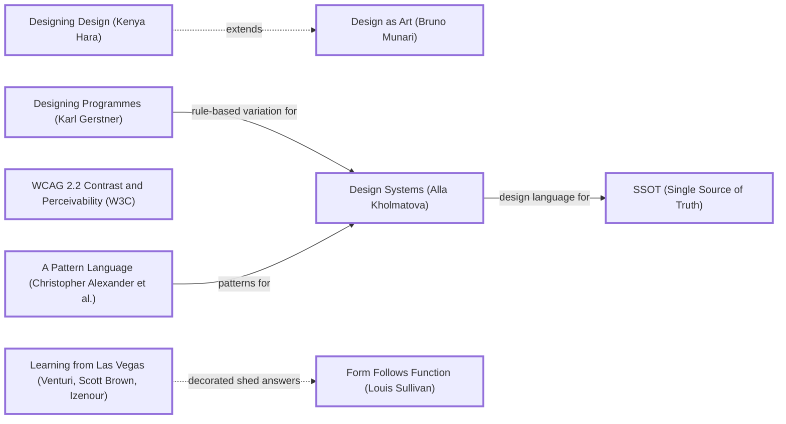

# DESIGN-LOG: site-repo (DADA run, 2026-11-11)

## Traversal Plan

**Brief, restated:** Turn five loose Tailwind snippets into a library of website parts that humans and agents can both use. The parts are copy-paste HTML templates, with a sandbox for seeing changes live, and the result should be designed well.

The owner's words: "Should eb a place for humans and agents to get template shit for building websites with a little sandbox or something to see chnages idk design good dada project".

**Mode: Adaptive.** The site serves a public of site builders and AI agents, so MAYA governs:
- The advanced pole is a kit of parts with an X-ray view.
- The acceptable pole is copy-paste HTML that works anywhere.

**Run type: Full** (a redesign).

**Bound:** none stated.

### Tooling (Step 0)

| Job | Tool |
|---|---|
| Graph | Mermaid text in this log (no renderer available) |
| Frontier | Edges grepped by hand from `references/anchor-graph.md` |
| Workflow state | This log |
| Panel | Agent tool, one sub-agent per seat, at most 3 at a time, each filing to `panel/<round>/<seat>.md` |
| Collect | `scripts/collect_panel.py` |
| Seating | `scripts/pick_panel.py --mode adaptive --run-type full --project site-repo` |
| Briefs | `seats/<id>.md` |
| Measurement | Playwright (`build/check.mjs`) |
| Ledger | SolutionsAsService/dada-changes (the owner's account), a session branch plus a patch file, as the other runs are recorded |

### Panel (from pick_panel.py)

| Seat | Why |
|---|---|
| Critic: Provocateur (Debord) | required (Adaptive) |
| Critic: Provocateur (Shklovsky) | required (Adaptive) |
| Critic: Inclusion (Holmes) | required (Adaptive) |
| Critic: Inclusion (Mace) | required (Adaptive) |
| Critic: Evidence (Cairo) | required: the artifact can be inspected |
| Critic: Usability (Krug) | rated 0.844 |
| Critic: Craft (Bringhurst) | rated 0.739 |
| Critic: Erasure (Kelly Walters) | rotation, 0 rounds on record |

The dotted pairs are Debord with Krug and Shklovsky with Krug.

**Witness:** none. The artifact describes no system owned by another party. The OpenStreetMap embed URL format is public and is checked by Cairo.

### Seed (exact labels)

- **Stance:** Design as Art (Bruno Munari).
- **Rules:** Designing Programmes (Karl Gerstner); WCAG 2.2 Contrast and Perceivability (W3C).
- **Systems:** Design Systems (Alla Kholmatova); A Pattern Language (Christopher Alexander et al.).
- **Breaker:** Learning from Las Vegas (Venturi, Scott Brown, Izenour).
- **Counterpoints (dotted):**
  - `hara -.->|extends| munariDA` — Designing Design (Kenya Hara).
  - `venturi2 -.->|decorated shed answers| sullivan` — Form Follows Function (Louis Sullivan).

Chain:

> Designing Programmes (Karl Gerstner) -->|rule-based variation for| Design Systems (Alla Kholmatova) · A Pattern Language (Christopher Alexander et al.) -->|patterns for| Design Systems (Alla Kholmatova) -->|design language for| SSOT (Single Source of Truth) · Design as Art (Bruno Munari) -.extends.- Designing Design (Kenya Hara) · Learning from Las Vegas (Venturi, Scott Brown, Izenour) -.->|decorated shed answers| Form Follows Function (Louis Sullivan).

### Initial Frontier

| Candidate | Reached via | From | Status |
|---|---|---|---|
| R0 objections | premortem | — | TAKEN (M1–M9) |
| Tokens as the programme's parameters | gerstner -->\|rule-based variation for\| kholmatova | Designing Programmes | TAKEN (M1) |
| Numbered patterns | alexPattern -->\|patterns for\| kholmatova | A Pattern Language | TAKEN (M2) |
| One source builds the gallery, the registry and the sandbox | kholmatova -->\|design language for\| c_ssot | Design Systems | TAKEN (M3) |
| The library dressed as a model kit (the sprue) | venturi2 (Breaker) | Learning from Las Vegas | TAKEN (M5) |
| Function shown bare, with no decoration (X-ray) | venturi2 -.-> sullivan | Form Follows Function | TAKEN (M6) |
| Emptiness as invitation: the sandbox starts blank-ish | hara -.-> munariDA | Designing Design | TAKEN (M4) |
| Accessibility as the taught default | wcag | WCAG 2.2 | TAKEN (M2, M7) |

---

## Panel, WHOLE, round R0 (premortem on commit 60a28d6; panel/R0/*.png; evidence panel/R0/evidence.md)

All 8 seats filed (`collect_panel.py`: 8 of 8).

| Critic | Anchor used | Observed in the work | Verdict | Requested change |
|---|---|---|---|---|
| Critic: Evidence (Cairo) | How Charts Lie | The evidence is accurate but incomplete: 2 of 3 icons were huge, not 3; there is no `</form>`; the map URL is malformed; the placeholder hrefs have spaces; CONTRIBUTING claims tests and a README that do not exist | OBJECT | Each part states its dependencies in the file; CONTRIBUTING made true |
| Critic: Usability (Krug) | Don't Make Me Think | No index: the first screen is a file list; a pasted part fails silently; dead nav links; the placeholders cannot be read by a machine | OBJECT | One sentence plus a preview of every part; a copy button and requirements; a gallery for humans and a manifest for agents from one source |
| Critic: Provocateur (Debord) | Society of the Spectacle | An image of navigation (4 dead pages), an image of contact (no backend), "X" on the bird | OBJECT | Declare requirements; the sandbox renders the exact copied source and shows what breaks |
| Critic: Inclusion (Holmes) | Mismatch | 0 of 4 labels; emoji names; untitled iframe; the parts work only for insiders | OBJECT | Labels; text names; titled map with a fallback; self-contained parts with a plain-language card |
| Critic: Inclusion (Mace) | Principles of Universal Design | Ring via box-shadow (lost in forced colours); inputs 21 px; nav links 4 px apart; active state by colour | OBJECT | `:focus-visible` outline; 44 px targets; aria-current; an access note per part; a forced-colours toggle |
| Critic: Craft (Bringhurst) | Elements of Typographic Style | No type system; stray "// Home Emoji"; emoji wordmark; capitals not letterspaced | OBJECT | Type tokens (base, leading, measure); show parts beside running text |
| Critic: Provocateur (Shklovsky) | Art as Technique | Every fragment is habitual; the only estrangement is the accidental 1000 px bird | OBJECT | A deliberate "bare / built" view in the sandbox |
| Critic: Erasure (Kelly Walters) | Black, Brown + Latinx Design Educators | Hidden prerequisites; docs that contradict the code; one locale | OBJECT | A "Needs:" line per part; vary the example people and places; add `lang` |

**Statements of meaning:** a library that promises parts and delivers fragments that depend on something unnamed.

**Andon:** none. Every objection becomes a Frontier item.

### Resolutions R0

| Finding | Resolution |
|---|---|
| Cairo + Debord + Walters + Holmes: hidden dependencies (Tailwind, undefined classes, API key, backend) | ADAPT (M1, M2): parts are plain HTML plus a scoped `<style>`; every token has a fallback value; each part's JSON header lists `needs` (empty for most) |
| Krug + Debord + Mace + Holmes + Walters: no labels, missing `</form>`, emoji names, untitled iframe, dead links | ADAPT (M2): rewritten parts with labels, text names, a titled OpenStreetMap embed (no key) with a text address, and slots instead of dead pages |
| Krug + Holmes: placeholders unreadable by machines; two front doors | ADAPT (M3): `data-slot` attributes plus a slot table in the JSON header; one source builds the gallery, the registry.json and llms.txt |
| Debord + Shklovsky: the sandbox must render the exact source and show what breaks | ADAPT (M4, M6): the preview is `srcdoc` = the copied string; the X-ray view strips the styles |
| Mace: focus by box-shadow; small targets; colour-only active state | ADAPT (M2, M7): `:focus-visible` outlines, 44 px targets, aria-current underline; probes in the check |
| Bringhurst: no type system; capitals not letterspaced | ADAPT (M1): tokens for body/display/mono faces, leading and measure; capitals letterspaced at 0.07–0.08em |
| Walters: one locale | ADAPT (M2, M8): varied people and places in the samples (Fremantle, Lagos, Mexico City), `lang` on every page |
| Cairo + Debord + Walters: CONTRIBUTING claims are false | ADAPT (M9): rewritten to match the build and check |
| Mace: a forced-colours / reduced-motion toggle in the sandbox | DEFERRED: the sandbox offers X-ray, widths and themes; forced colours are tested by the check. Logged on the Frontier |

---

## Decision Records

## Move M1: Tokens as the programme  (KEEP-THE-RULE)
Depends on: none
Anchors: Rule Designing Programmes (Karl Gerstner) | System Design Systems (Alla Kholmatova)
Intent: One `tokens.css` holds 15 variables for colour, radius, space, width, measure, leading and three faces. `themes.json` holds 4 presets (Paper, Night, Citrus, Slab). Every part reads only these tokens, each with a fallback, so a part works pasted alone and re-themes when the tokens change.
Formal argument: Gerstner's programme is a set of rules that generates many solutions. Kholmatova's design language makes those rules shared and named. Fallbacks make the programme degrade gracefully.
Alternatives rejected:
- (a) Keep Tailwind. Rejected: it was the hidden dependency.
- (b) One global stylesheet. Rejected: a part copied alone would lose its styles.
Consequence: Each part carries about 1–2 KB of scoped CSS. Some duplication is accepted for portability.
Fence: n/a.
Frontier effect: Theme switching in the sandbox and on the landing; contrast checks per theme.
Mode field: The advanced pole is that one edit re-themes every part. The acceptable pole is CSS variables anyone can read.

## Move M2: Eighteen numbered parts  (KEEP-THE-RULE)
Depends on: M1
Anchors: System A Pattern Language (Christopher Alexander et al.) | Rule WCAG 2.2 Contrast and Perceivability (W3C)
Intent: Rewrite the 5 fragments and add 13 more, for 18 parts in 7 groups. Each starts with a JSON header: id, title, category, summary, slots, needs and a11y notes. Each part is numbered by the build like Alexander's patterns (No. 01–18) and lettered by group (A–G).
Formal argument: Alexander's patterns are numbered, named and cross-referenced so non-experts can compose them. Accessibility is built in, so every copy teaches it.
Alternatives rejected:
- (a) A huge library of 100+ parts. Rejected: quality cannot be checked.
- (b) Keep the old 5 and patch them. Rejected: every one fails R0.
Consequence: The sample copy must be real-sounding and varied (Walters).
Fence: n/a.
Frontier effect: The check probes each part at 3 widths.
Mode field: The advanced pole is a numbered pattern language. The acceptable pole is copy-paste HTML.

## Move M3: One source builds three doors  (KEEP-THE-RULE)
Depends on: M1, M2
Anchors: Catalog SSOT (Single Source of Truth) | System Design Systems (Alla Kholmatova)
Intent: `build/build.mjs` reads `parts/` and `templates/` and writes:
- the human site (landing, part pages, templates, sandbox, agents page)
- the agent doors: `registry.json` (every part with its metadata, raw URL, sha256 and check results), `llms.txt`, and the raw files under `/raw/`
- the repo's `AGENTS.md`, which explains the format.
Formal argument: Two front doors (Krug) from one source cannot disagree.
Alternatives rejected:
- (a) A separate docs site. Rejected: it drifts.
- (b) A framework such as Astro. Rejected: it adds a dependency to a no-dependency library.
Consequence: A Node build step for the site only; the parts themselves need none.
Fence: n/a.
Frontier effect: Registry hashes must match the raw files (probe).
Mode field: The advanced pole is a machine registry. The acceptable pole is a gallery.

## Move M4: The sandbox  (KEEP-THE-RULE)
Depends on: M1, M3
Anchors: Stance Design as Art (Bruno Munari) | Counterpoint Designing Design (Kenya Hara) (dotted "extends")
Intent:
- Pick parts to stack into a page and edit the HTML in a code box.
- Change the tokens with controls (accent, ink, paper, radius, display face) or a theme preset.
- See the result in a frame at 375, 768 or 1280 width.
- Copy or download the exact document shown. The preview `srcdoc` is the same string that is copied.
- State is kept in the URL hash (part ids and tokens), so a link reproduces the page.
Formal argument: Munari wants design to be used, not admired. Hara's emptiness invites making. The sandbox opens with three parts, not a finished site.
Alternatives rejected:
- (a) An embedded CodePen or Monaco. Rejected: a network dependency.
- (b) A preview only, with no editing. Rejected: the brief says "see changes".
Consequence: A plain textarea editor, with no syntax colouring.
Fence: n/a.
Frontier effect: X-ray (M6); probe that the preview equals the copy.
Mode field: The advanced pole is a live, themeable assembly. The acceptable pole is a textarea and a frame.

## Move M5: The landing as a sprue  (BREAK)
Depends on: M2, M3
Anchors: Breaker Learning from Las Vegas (Venturi, Scott Brown, Izenour) | Stance Design as Art (Bruno Munari)
Intent: The first screen is a model-kit sprue: a frame with runners holding all 18 parts as live miniatures. Each part has its letter-number (A1, B2…) on a tab and links to its page. A theme switcher on the frame re-themes every miniature at once. An "assembly instructions" panel links to Sandbox, Templates and Agents.
Formal argument: Venturi's decorated shed lets the sign be the building. Here the library's sign is a kit, and the kit is the content: live parts, not screenshots. Shklovsky's estrangement: the web page seen as a moulded part, the habitual seen anew.
Alternatives rejected:
- (a) A grid of cards. Rejected: the habitual form.
- (b) One big demo page as the hero. Rejected: it does not summarize the 18 parts or the other doors.
Consequence: 18 iframes on the first screen. On a phone, show one part per group (7) and a "+11" tab, measured against the fold.
Fence: A card grid exists because it scans; the sprue keeps a grid (the runners) and changes only its dress.
Frontier effect: First-screen and legibility probes; theme switch probe.
Mode field: The advanced pole is a kit sprue of live parts. The acceptable pole is labelled tabs, a grid, and links.

## Move M6: X-ray  (BREAK; counterpoint applied)
Depends on: M4
Anchors: Counterpoint Form Follows Function (Louis Sullivan) (dotted from Learning from Las Vegas) | Breaker Learning from Las Vegas (Venturi, Scott Brown, Izenour)
Intent: A toggle on every part page and in the sandbox removes the part's styles and draws each element's tag and each `data-slot` name on it, showing the bare structure an agent fills.
Formal argument: Shklovsky asked for "bare / built". Sullivan's counterpoint to Venturi says the shed must also show its function, and X-ray is the function seen without its decoration.
Alternatives rejected:
- (a) A view-source panel only. Rejected: it shows code, not structure.
- (b) Browser devtools. Rejected: not for everyone.
Consequence: X-ray CSS injected only in previews, never in copied code.
Fence: n/a.
Frontier effect: Probe that X-ray changes the preview and leaves the copy unchanged.
Mode field: The advanced pole is that the structure is seen. The acceptable pole is a labelled toggle.

## Move M7: The check, published  (KEEP-THE-RULE)
Depends on: M2, M3
Anchors: Rule WCAG 2.2 Contrast and Perceivability (W3C)
Intent: `build/check.mjs` renders every part alone at 375, 768 and 1280 under each theme. It checks:
- overflow
- labels
- target size
- focus ring after a real Tab
- text contrast
- the presence of the JSON header and slots

Results are written into `registry.json` and shown on each part page. A failing fixture proves the probes work.
Formal argument: Debord: a library's claims must be earned. A published check turns a claim into evidence.
Alternatives rejected:
- (a) A badge with no data. Rejected: that is spectacle.
- (b) Manual review only. Rejected: it cannot be reproduced.
Consequence: Building takes about a minute longer.
Fence: n/a.
Frontier effect: Figures on the site come from the check.
Mode field: The advanced pole is per-part evidence. The acceptable pole is "passes at 375/768/1280".

## Move M8: Templates  (KEEP-THE-RULE)
Depends on: M2, M3
Anchors: System A Pattern Language (Christopher Alexander et al.)
Intent: Four full pages composed from parts with `<!--@part id-->` includes and overridden copy: a garden studio (Fremantle), an event (Lagos), a portfolio (Mexico City), and a product launch.
Formal argument: Alexander's patterns are proven only in a building. Templates show the parts composing.
Alternatives rejected:
- (a) No templates. Rejected: humans need a starting page.
- (b) A template per industry. Rejected: too many.
Consequence: Overrides are applied by string replacement in the build.
Fence: n/a.
Frontier effect: Templates are checked like parts.
Mode field: The advanced pole is composed from the pattern language. The acceptable pole is a page to start from.

## Move M9: Delete the old fragments; make the docs true  (KEEP-THE-RULE)
Depends on: M2
Anchors: Rule Designing Programmes (Karl Gerstner)
Intent: Delete navbar.html, forms.html, dividers.html, maps.html and social-media.html (each is replaced by a part). Rewrite CONTRIBUTING to describe the build, the check and the part format. Add a README and AGENTS.md.
Formal argument: Step 2f: each old file earns nothing its replacement does not hold.
Alternatives rejected:
- (a) Keep them in `legacy/`. Rejected: they would be copied.
- (b) Keep the docs as they are. Rejected: they are false.
Consequence: Old URLs disappear; there were no pages linking to them.
Fence: n/a.
Frontier effect: Residual diff.
Mode field: n/a.
